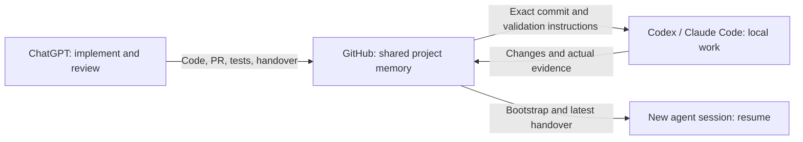

# collaboration

A Git-based handover protocol for independent coding agents and repository-aware chats. Unlike dispatch, it does not invoke external CLIs or rely on shared conversation history. It is useful for switching between ChatGPT, Codex, Claude Code or other agents, including work requiring hardware or private local integrations.

## See it work

**Different agents. One project. Continuous development.** Unlike live delegation, this workflow does not need both agents running at the same time.

### Example: implement remotely, validate locally, resume in a fresh chat

Imagine an application with a GPU-dependent camera feature. ChatGPT can implement a portable change, but only your laptop can verify the actual camera and GPU behavior. The same workflow applies to mobile apps, physical devices, private integrations and ordinary software projects.

The following is an illustrative exchange, not a recorded test run.

**1. Start with ChatGPT.** Open a new conversation with access to the project repository and use the [new-chat bootstrap](skills/agent-handover/references/CHAT-BOOTSTRAP.md).

> Use the agent-handover skill. Implement issue #42 on a separate branch, run the available tests, and prepare a handover for local Codex.

ChatGPT inspects the repository, implements the authorized change, commits it and prepares a pull request and handover. The handover identifies the exact code commit, passed tests, tests not run, local prerequisites and acceptance criteria.

**2. Continue with Codex or Claude Code on your laptop.** Open the project checkout and supply the PR or handover link.

> Use the agent-handover skill. Review the handover for issue #42. Validate the camera feature on this machine, fix any problems within scope, record the evidence and return a checkpoint.

The local agent checks its working tree, reads the agreed commit, runs the hardware-dependent tests, and records the actual results. When authorized, it commits and pushes the work and links the updated handover.

**3. Pick up the work in a new ChatGPT conversation.** Use the same bootstrap with the project repository and latest PR or handover link.

> Review the latest handover for issue #42. Check the implementation and local test evidence. Recommend acceptance or remaining fixes.

The receiving agent reconstructs context from the repository, not from the earlier chat. It distinguishes reported results from tests it can independently verify. The user decides whether to merge.



### Stop one agent and continue with another

> Reach a safe checkpoint using agent-handover. Preserve unfinished work, run relevant tests, commit and push the scoped changes, record the handover, and stop.

The agent returns the repository, branch, implementation commit, handover commit, PR or issue, test results and blockers. Give the next agent those references. No live session transfer, automatic agent launch or hidden shared memory is required.

### What stays in the project

The project repository holds its own instructions, issues, code, PRs, status and handover records (for example, `docs/handovers/`). The reusable skill lives in sparkling-skills. Do not store private project data in the shared skills repository.

## Installation

The same portable skill works in both Codex and Claude Code. Choose one installation method per agent to avoid duplicate skills. You need Git and access to this repository; no additional AI CLI or API key is required by the handover skill itself.

### Codex — install for all projects (recommended)

On macOS or Linux, run in your terminal:

```sh
git clone https://github.com/sparklingneuronics/sparkling-skills.git "$HOME/sparkling-skills"
src="$HOME/sparkling-skills/plugins/collaboration/skills/agent-handover"
dest="$HOME/.agents/skills/agent-handover"
if [ -f "$src/SKILL.md" ] && [ ! -e "$dest" ] && [ ! -L "$dest" ]; then
  mkdir -p "$(dirname "$dest")" && cp -R "$src" "$dest"
else
  echo "Source missing or destination already exists; inspect before copying."
fi
```

These commands assume a fresh clone of the default branch. If you already cloned the repository, skip the clone and use its actual path. To install **only for one project**, run the copy block from that project's root with `dest="$PWD/.agents/skills/agent-handover"` instead. Start a new Codex session in your target project. Select the skill with `$agent-handover` or ask in plain language, for example: "Use the agent-handover skill to recover the current project context. Do not modify anything."

### Claude Code — marketplace installation

In your terminal, add the marketplace once and install:

```sh
claude plugin marketplace add sparklingneuronics/sparkling-skills
claude plugin install collaboration@sparkling-skills --scope user
```

For one project, run from the project root with `--scope project` instead; use `--scope local` for your personal installation in that project only. If the marketplace was already added, refresh it before installing the new plugin. In an interactive Claude Code session the equivalent commands are:

```text
/plugin marketplace add sparklingneuronics/sparkling-skills
/plugin install collaboration@sparkling-skills
```

Select the desired scope in the installation panel. Start a new session or reload plugins when prompted. Invoke `/collaboration:agent-handover` or request the skill by name. Verify the skill is listed before relying on it.

### Claude Code — manual installation (alternative)

Use the same clone and copy commands as for Codex, replacing the destination with `$HOME/.claude/skills/agent-handover` for all projects, or `$PWD/.claude/skills/agent-handover` for one project. A manually installed standalone skill is invoked as `/agent-handover`. Do not also enable the marketplace copy unless you intentionally want both.

### Windows PowerShell — manual installation for either agent

From PowerShell:

```powershell
git clone https://github.com/sparklingneuronics/sparkling-skills.git "$HOME/sparkling-skills"
$src = Join-Path $HOME "sparkling-skills/plugins/collaboration/skills/agent-handover"
$dest = Join-Path $HOME ".agents/skills/agent-handover"
if ((Test-Path (Join-Path $src "SKILL.md")) -and -not (Test-Path $dest)) {
    New-Item -ItemType Directory -Force -Path (Split-Path $dest) | Out-Null
    Copy-Item -LiteralPath $src -Destination $dest -Recurse
} else {
    Write-Output "Source missing or destination already exists; inspect before copying."
}
```

For Claude Code use `.claude/skills/agent-handover` instead. For project scope, set the destination relative to the target project's root instead of `$HOME`. Keep the entire skill directory, including references.

### ChatGPT / remote or cloud sessions

No local installation is necessary if the agent can read the skill and project repository. Use the [new-chat bootstrap](skills/agent-handover/references/CHAT-BOOTSTRAP.md). Local skills or plugin installs do not automatically carry over to a cloud session; explicitly provide the accessible skill URL or include a reviewed project-local skill where supported.

### Updates, removal and verification

Manual copies are snapshots. To update, fetch the approved revision in your skills checkout, compare with the installed copy, then replace it deliberately (preserve local customizations). To remove, delete only the installed agent-handover directory after confirming its path. For Claude Code marketplace installs use the plugin panel or `claude plugin uninstall collaboration@sparkling-skills --scope user` (match your install scope).

Check that the installed `SKILL.md` and its references exist and ask the agent for a read-only project summary using the skill. No writes, commits or external agent launches should occur on that prompt.

Official installation references: [OpenAI CLI skill installation](https://developers.openai.com/api/reference/cli), [Claude Code skills](https://code.claude.com/docs/en/skills), [Claude Code plugin installation](https://code.claude.com/docs/en/discover-plugins). Commands are documented against these sources; live discovery and installation in the local CLIs remain to be verified.

- [Agent handover skill](skills/agent-handover/SKILL.md)
- [Handover template](skills/agent-handover/references/HANDOVER-TEMPLATE.md)
- [New-chat bootstrap and short prompts](skills/agent-handover/references/CHAT-BOOTSTRAP.md)

## Workflow

The user authorizes a bounded task; the sending agent commits scoped changes, records the actual implementation SHA, records available test results, and verifies the pushed handover. The receiving agent reads the issue, PR, handover and source at the specified ref, checks its capabilities and ownership, and performs authorized work. Environment-specific checks are explicitly marked not run or blocked until performed. Project instructions govern merging and release.

## Validation before release

Run the repository's existing release checks and `claude plugin validate .` from the repository root. Validate the standalone plugin with the installed CLI's supported validation command. Exercise the cases in [evals/README.md](skills/agent-handover/evals/README.md). Live CLI discovery and cross-agent behavioral evaluations have not been independently verified here; no external CLI is invoked by the skill itself.
